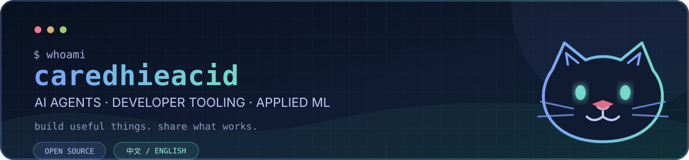

<p align="center">
  
</p>

<p align="center">
  <a href="https://github.com/caredhieacid?tab=repositories"></a>
  <a href="https://github.com/caredhieacid/jensenmo-happy_coding_everyday"></a>
  <a href="https://gitee.com/caredhieacid"></a>
</p>

## Hello / 你好 👋

I build practical **AI agents**, **developer tools**, and **applied machine-learning projects**. I like systems that keep humans in control, make their boundaries explicit, and are useful outside a demo.

我主要在做实用的 **AI Agent、开发者工具与应用型机器学习项目**，也会把过去的比赛和课程项目整理后开源。相比“看起来很智能”，我更在意工具是否可控、边界是否清楚、别人能否真正复用。

- 🧭 Current focus: agent workflows, Codex skills, computer vision, and small tools with clear safety boundaries
- 🛠️ Languages and tools: Python, TypeScript, GitHub Actions, OpenCV, YOLO, HarmonyOS
- 🤝 Open to thoughtful issues, documentation fixes, and focused pull requests

## Selected work / 精选项目

<table>
  <tr>
    <td width="50%" valign="top">
      <h3><a href="https://github.com/caredhieacid/fund-copilot">Fund Copilot / 基金副驾</a></h3>
      <p>A bounded AI agent skill that screens Chinese mutual funds from public data. It does not log in, place orders, or pretend to predict the market.</p>
      <p><code>Python</code> <code>Agent Skill</code> <code>AKShare</code></p>
    </td>
    <td width="50%" valign="top">
      <h3><a href="https://github.com/caredhieacid/jensenmo-happy_coding_everyday">HappyCoding Everyday</a></h3>
      <p>One automatic Codex coding entrance that scales rigor from everyday fixes to bounded collaboration and full delivery.</p>
      <p><code>Codex</code> <code>Agent Workflow</code> <code>Python</code></p>
    </td>
  </tr>
  <tr>
    <td width="50%" valign="top">
      <h3><a href="https://github.com/caredhieacid/End-to-End-Multi-Source-Information-Fusion-and-Classroom-Interaction-Behavior-Analysis-System">ClassSense</a></h3>
      <p>A desktop classroom-analysis system that combines face, emotion, pose, and object detection into one visual workflow.</p>
      <p><code>Python</code> <code>YOLO</code> <code>PyQt</code></p>
    </td>
    <td width="50%" valign="top">
      <h3><a href="https://github.com/caredhieacid/anti-drone-aiming-aid">Anti-Drone Aiming Aid</a></h3>
      <p>Real-time target detection, calibration, and aiming assistance built with YOLOv11, OpenCV, and a desktop GUI.</p>
      <p><code>Computer Vision</code> <code>OpenCV</code> <code>YOLOv11</code></p>
    </td>
  </tr>
  <tr>
    <td colspan="2" valign="top">
      <h3><a href="https://github.com/caredhieacid/momo-word-masterharmonyos-5.0">Momo Word Master</a></h3>
      <p>A HarmonyOS 5 vocabulary-learning app with review schedules, daily check-ins, multiple learning modes, and AI-assisted conversation practice.</p>
      <p><code>HarmonyOS</code> <code>ArkTS</code> <code>Learning App</code></p>
    </td>
  </tr>
</table>

## How I build / 我的原则

```text
useful over flashy  ·  evidence over guesses  ·  copilot over autopilot
```

If one of these projects is useful to you, an issue describing the real use case is more valuable than a generic compliment. Contributions are welcome when they keep the scope clear and the project easier to understand.

<p align="center">
  <sub>Thanks for stopping by. 感谢来访，祝你今天也写出一点有用的东西。</sub>
</p>
