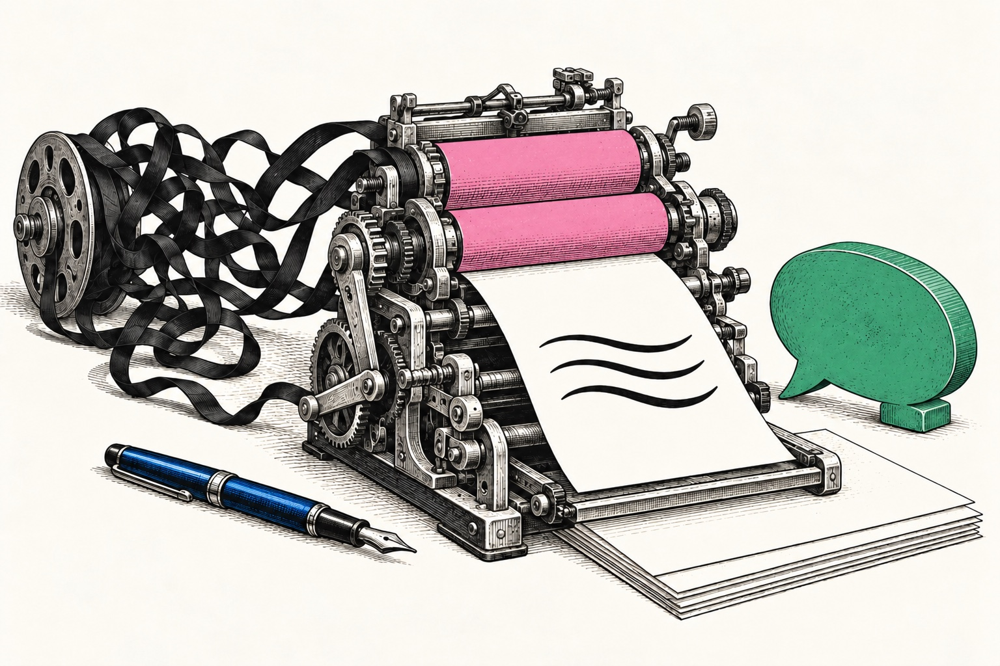
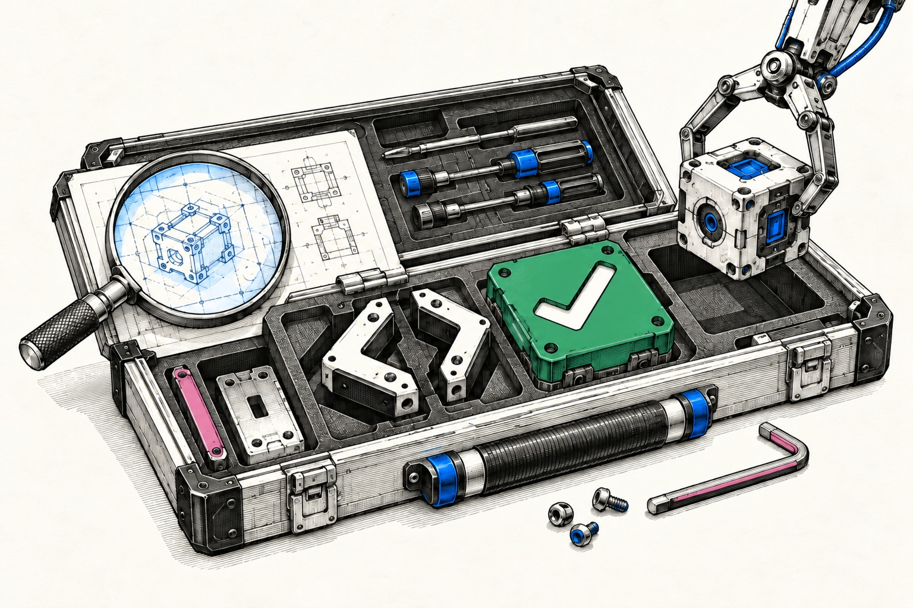
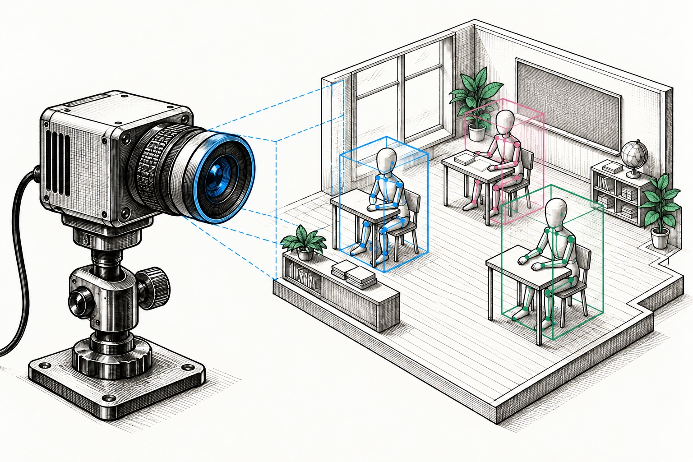

# Jensen

**Algorithms · AI Infrastructure · Full-Stack Development** &nbsp; / &nbsp; `@caredhieacid`

<!-- Original AI-generated editorial artwork; conceptual illustrations, not product screenshots. -->

  

  
  
  

个人项目陆续开源。

## Selected work

<table>
<tr>
<td width="50%" valign="top">
  
  <h3><a href="https://github.com/caredhieacid/talk-like-a-human">像人一样说话 ↗</a></h3>
  
面向 AI Agent 的中英文写作规范。

  
<code>Agent Skill</code> <code>Writing</code> <code>中文 / EN</code>

  
<a href="https://github.com/caredhieacid/talk-like-a-human#examples">看改写对比 →</a>

</td>
<td width="50%" valign="top">
  
  <h3><a href="https://github.com/caredhieacid/jensenmo-happy_coding_everyday">HappyCoding Everyday ↗</a></h3>
  
涵盖问题分析、代码修改与验证的 AI 编程工作流。

  
<code>Agent Skill</code> <code>Workflow</code> <code>Python</code>

</td>
</tr>
<tr>
<td width="50%" valign="top">
  
  <h3><a href="https://github.com/caredhieacid/fund-copilot">Fund Copilot · 基金副驾 ↗</a></h3>
  
基于公开数据的公募基金筛选与研究工具。

  
<code>Python</code> <code>AKShare</code> <code>Agent Skill</code>

</td>
<td width="50%" valign="top">
  
  <h3><a href="https://github.com/caredhieacid/End-to-End-Multi-Source-Information-Fusion-and-Classroom-Interaction-Behavior-Analysis-System">ClassSense ↗</a></h3>
  
融合人脸、表情、姿态与目标检测的课堂行为分析系统。

  
<code>Python</code> <code>YOLO</code> <code>PyQt</code>

</td>
</tr>
</table>

**More to explore** &nbsp; [Momo Word Master · HarmonyOS 单词学习](https://github.com/caredhieacid/momo-word-masterharmonyos-5.0) &nbsp; / &nbsp; [Golden Agent · 市场信息看板](https://github.com/caredhieacid/Golden-Agent)

## Toolbox

**AI &amp; Agents**

  
  
  

**Languages &amp; Frameworks**

  
  
  
  

**Vision &amp; Tooling**

  
  
  
  

---

[All repositories ↗](https://github.com/caredhieacid?tab=repositories) &nbsp; · &nbsp; [Gitee ↗](https://gitee.com/caredhieacid)
